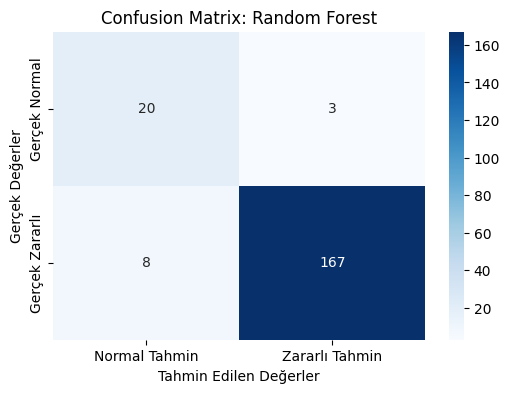
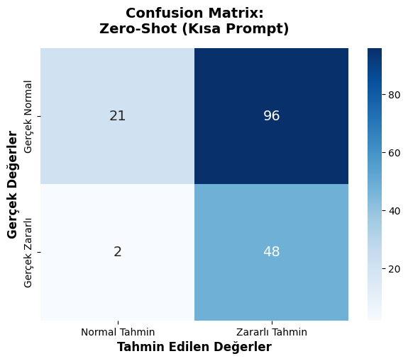

# Network Attack Detection: Classical ML vs. LLMs

Detecting malicious network traffic in self-captured lab data, and comparing **classical machine learning** with **large language models** prompted on human-readable traffic summaries.

**Headline results:** Random Forest reaches **94% accuracy** (attack F1 0.97). A locally hosted **Llama 3** catches **96–98% of attacks** without any training, but it also raises false alarms on most normal traffic.

## Dataset

Traffic was captured with Wireshark in a lab network:

| Capture | Label |
|---|---|
| Everyday browsing / background traffic (4 captures) | normal |
| ARP spoofing (MitM) | malicious |
| ARP + DNS spoofing | malicious |
| DHCP poisoning | malicious |
| Nmap port scan | malicious |

Each capture is split into **5-second windows**, and each window becomes one sample. Raw captures are not published because they contain lab network addresses (see [`data/README.md`](data/README.md)).

## Pipeline

| # | Notebook | What it does |
|---|---|---|
| 01 | [`01_pcap_to_windowed_dataset.ipynb`](notebooks/01_pcap_to_windowed_dataset.ipynb) | Scapy: pcap → 5 s windows → tabular features (protocols, packet count, ports, payload summary). 117 normal and 872 malicious windows. |
| 02 | [`02_ml_supervised_vs_unsupervised.ipynb`](notebooks/02_ml_supervised_vs_unsupervised.ipynb) | Supervised (RF, SVM, MLP) vs. unsupervised (Isolation Forest, K-Means, Autoencoder), with SMOTE on the training set |
| 03 | [`03_pcap_to_json_for_llm.ipynb`](notebooks/03_pcap_to_json_for_llm.ipynb) | PyShark: pcap → JSON windows with packet-by-packet text logs for LLM prompts (167 windows) |
| 04 | [`04_llm_classification_llama3.ipynb`](notebooks/04_llm_classification_llama3.ipynb) | Llama 3 via Ollama: zero-shot (short / long) and few-shot prompting |

## Results

### Stage 1: Classical ML (198 test windows)

| Approach | Model | Accuracy | F1 (normal) | F1 (malicious) |
|---|---|---|---|---|
| Supervised | **Random Forest** | **0.94** | **0.78** | **0.97** |
| Supervised | SVM (RBF) | 0.91 | 0.64 | 0.95 |
| Supervised | MLP | 0.91 | 0.67 | 0.95 |
| Unsupervised | K-Means | 0.56 | 0.29 | 0.68 |
| Unsupervised | Autoencoder | 0.27 | 0.24 | 0.29 |
| Unsupervised | Isolation Forest | 0.12 | 0.10 | 0.14 |

### Stage 2: LLM prompting with Llama 3 (167 windows: 117 normal, 50 malicious)

| Prompt | Accuracy | Precision | Recall | F1 |
|---|---|---|---|---|
| Zero-shot (short) | **0.413** | **0.333** | 0.96 | **0.495** |
| Zero-shot (long, analyst persona + rules) | 0.311 | 0.301 | **0.98** | 0.460 |
| Few-shot (2 examples) | 0.365 | 0.316 | 0.96 | 0.475 |

## Key findings

- **Supervised learning wins clearly.** Even a small, imbalanced dataset is enough for Random Forest to separate attack windows reliably.
- **Unsupervised anomaly detection failed here, and the reason is instructive.** Attacks make up 88% of the windows, which breaks the core assumption of anomaly detection that attacks are rare. On this data the "anomaly" is the normal traffic.
- **LLMs are over-cautious detectors.** Without training, Llama 3 flags almost every attack (recall ≥ 96%), but it also flags most normal traffic as malicious (precision ~30%). A more detailed "expert" prompt made this worse, not better. This suggests prompting alone is not enough; fine-tuning or retrieval with labelled examples would be the next step.
- An earlier attempt with the Gemini API was stopped by free-tier rate limits, which motivated switching to a **locally hosted model (Ollama)** that has no quota or cost.

## Run it

All notebooks were written for Google Colab.

1. Put your captures under `pcap_verileri/normal/` and `pcap_verileri/zararli/` on Google Drive, then run notebook **01**.
2. Upload the generated `normal_dataset.csv` and `zararli_dataset.csv` and run notebook **02**.
3. Run notebook **03** in the folder that holds the `.pcapng` files to create `dataset.json`.
4. Switch to a **GPU runtime**, upload `dataset.json` and run notebook **04**. It installs Ollama and pulls Llama 3 automatically.

To run locally, use `pip install -r requirements.txt`. Notebook 03 also needs `tshark` (Wireshark CLI).

## Tech stack

Python · Scapy · PyShark / tshark · pandas · scikit-learn · imbalanced-learn (SMOTE) · TensorFlow / Keras · Ollama · Llama 3 · matplotlib / seaborn

## Limitations

- Small dataset from a single lab network. Results will not transfer directly to real enterprise traffic.
- Windows are split randomly, so windows from the same capture can appear in both training and test sets. A split by capture file would be a stricter test.
- The two stages use different feature extractions and test sets, so their numbers are not a strict head-to-head comparison.

---

Developed as a course project at Ankara University, Computer Engineering (Spring 2026).
Author: **Simge Karsavuranoğlu**
